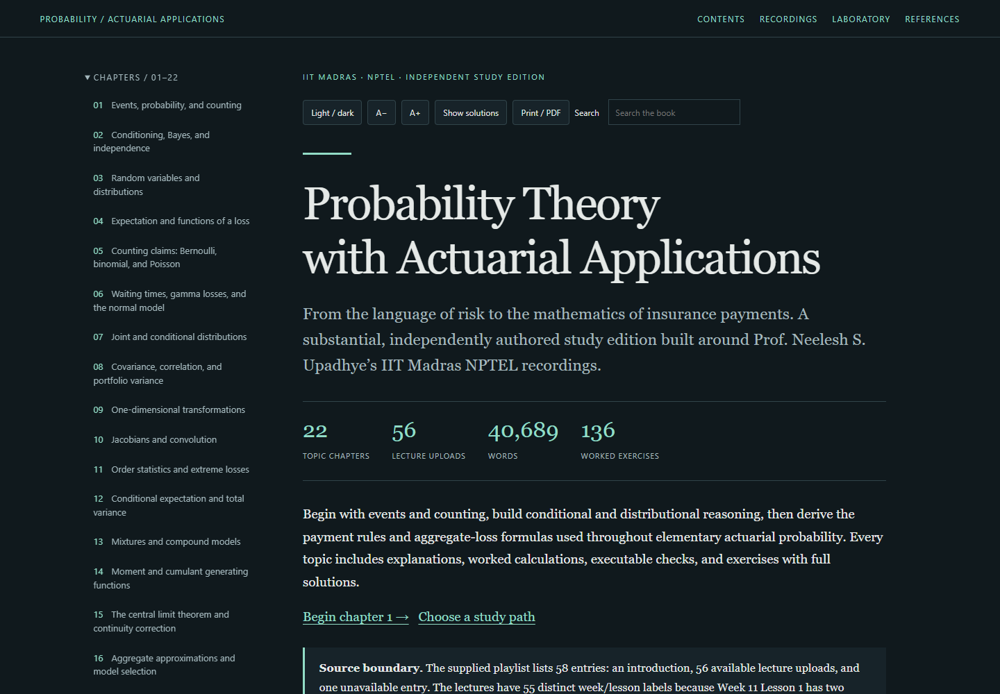

# Probability Theory with Actuarial Applications — a textbook rewrite

**[Read the live textbook](https://az9713.github.io/nptel-probability-theory-with-actuarial-applications-iitm-notes/)**

An independent, substantial rewrite and expansion of Prof. Neelesh S. Upadhye's
IIT Madras NPTEL course, [Probability Theory with Actuarial Applications](https://nptel.ac.in/courses/111106929).
The [supplied YouTube playlist](https://www.youtube.com/playlist?list=PLyqSpQzTE6M-6uZtCcdhLS-HiXzQ43Bw2)
sets the coverage; the notes develop their own explanations, definitions,
derivations, interpreted calculations, original examples and worked exercises.

**Complete for every available lecture upload in the supplied playlist:**
22 topic chapters covering 56 uploads (27.2 hours), approximately
40,689 words of chapter text including formulas and exercises but excluding
code/output, 136 chapter exercises with full solutions, and 23 executed
standalone Python programs. A separate original concentration appendix adds five
worked exercises. The final chapter expands all thirty mock-examination problems.

The supplied playlist has 58 listed entries: an introduction, 56 available lecture
uploads, and one unavailable entry. Its teaching labels are out of upload order;
Week 11 Lesson 1 has two distinct uploads, both retained and read. **No Week 8
recordings appear.** The original appendix supplies a proved concentration/LLN
bridge without claiming to reconstruct those missing lectures.

## Read the chapters

| Chapter | Reading edition | Source week |
|---|---|---|
| 1 | [Events, probability, and counting](https://az9713.github.io/nptel-probability-theory-with-actuarial-applications-iitm-notes/chapter-01-events-and-counting.html) | 1 |
| 2 | [Conditioning, Bayes, and independence](https://az9713.github.io/nptel-probability-theory-with-actuarial-applications-iitm-notes/chapter-02-conditioning-and-bayes.html) | 1 |
| 3 | [Random variables and distributions](https://az9713.github.io/nptel-probability-theory-with-actuarial-applications-iitm-notes/chapter-03-random-variables.html) | 2 |
| 4 | [Expectation and functions of a loss](https://az9713.github.io/nptel-probability-theory-with-actuarial-applications-iitm-notes/chapter-04-expectation.html) | 2 |
| 5 | [Counting claims: Bernoulli, binomial, and Poisson](https://az9713.github.io/nptel-probability-theory-with-actuarial-applications-iitm-notes/chapter-05-claim-counts.html) | 3 |
| 6 | [Waiting times, gamma losses, and the normal model](https://az9713.github.io/nptel-probability-theory-with-actuarial-applications-iitm-notes/chapter-06-severity-families.html) | 3 |
| 7 | [Joint and conditional distributions](https://az9713.github.io/nptel-probability-theory-with-actuarial-applications-iitm-notes/chapter-07-joint-distributions.html) | 4 |
| 8 | [Covariance, correlation, and portfolio variance](https://az9713.github.io/nptel-probability-theory-with-actuarial-applications-iitm-notes/chapter-08-dependence.html) | 4 |
| 9 | [One-dimensional transformations](https://az9713.github.io/nptel-probability-theory-with-actuarial-applications-iitm-notes/chapter-09-transformations.html) | 5 |
| 10 | [Jacobians and convolution](https://az9713.github.io/nptel-probability-theory-with-actuarial-applications-iitm-notes/chapter-10-jacobians-and-convolution.html) | 5 |
| 11 | [Order statistics and extreme losses](https://az9713.github.io/nptel-probability-theory-with-actuarial-applications-iitm-notes/chapter-11-order-statistics.html) | 5 |
| 12 | [Conditional expectation and total variance](https://az9713.github.io/nptel-probability-theory-with-actuarial-applications-iitm-notes/chapter-12-total-moments.html) | 6 |
| 13 | [Mixtures and compound models](https://az9713.github.io/nptel-probability-theory-with-actuarial-applications-iitm-notes/chapter-13-mixtures-and-compounding.html) | 6 |
| 14 | [Moment and cumulant generating functions](https://az9713.github.io/nptel-probability-theory-with-actuarial-applications-iitm-notes/chapter-14-generating-functions.html) | 7 |
| 15 | [The central limit theorem and continuity correction](https://az9713.github.io/nptel-probability-theory-with-actuarial-applications-iitm-notes/chapter-15-central-limit-theorem.html) | 9 |
| 16 | [Aggregate approximations and model selection](https://az9713.github.io/nptel-probability-theory-with-actuarial-applications-iitm-notes/chapter-16-aggregate-approximations.html) | 9 |
| 17 | [Losses, payments, and deductibles](https://az9713.github.io/nptel-probability-theory-with-actuarial-applications-iitm-notes/chapter-17-deductibles.html) | 10 |
| 18 | [Policy limits, layers, and stop-loss](https://az9713.github.io/nptel-probability-theory-with-actuarial-applications-iitm-notes/chapter-18-policy-layers.html) | 10 |
| 19 | [Random sums and aggregate-loss moments](https://az9713.github.io/nptel-probability-theory-with-actuarial-applications-iitm-notes/chapter-19-aggregate-moments.html) | 11 |
| 20 | [Severity moments and aggregate-loss design](https://az9713.github.io/nptel-probability-theory-with-actuarial-applications-iitm-notes/chapter-20-aggregate-design.html) | 11 |
| 21 | [An integrated probability toolkit](https://az9713.github.io/nptel-probability-theory-with-actuarial-applications-iitm-notes/chapter-21-integrated-toolkit.html) | 12 |
| 22 | [Mock examination: mechanisms and worked solutions](https://az9713.github.io/nptel-probability-theory-with-actuarial-applications-iitm-notes/chapter-22-mock-examination.html) | 12 |

Explore the [study guide](https://az9713.github.io/nptel-probability-theory-with-actuarial-applications-iitm-notes/study-guide.html),
[recording and source map](https://az9713.github.io/nptel-probability-theory-with-actuarial-applications-iitm-notes/source-map.html),
[interactive laboratory](https://az9713.github.io/nptel-probability-theory-with-actuarial-applications-iitm-notes/numerical-lab.html),
[concentration appendix](https://az9713.github.io/nptel-probability-theory-with-actuarial-applications-iitm-notes/appendix-concentration.html), and
[primary references](https://az9713.github.io/nptel-probability-theory-with-actuarial-applications-iitm-notes/references.html).

## What the edition adds

- Explicit assumptions, local notation, full derivations and interpreted checks.
- A consistent loss-to-payment-to-aggregate modeling sequence, distinguishing
  per-loss and per-payment moments, mixed and compound models, and a ground-up
  ceiling from a payment cap.
- Original standalone programs with meaningful assertions, exact source parity,
  and their actual output beside the explanation.
- Worked exercises that test derivation, support, dependence, limiting cases and
  model selection, with complete expandable solutions.
- Three interactive mathematical models: insurance layers and compound-Poisson
  moments, Bayesian updating with a rare class, and correlated diversification.
- An offline reader with local MathJax, full-text search, dark/light themes, text
  controls, code copying, previous/next links, mobile layouts and printable solutions.

A timestamp locates related lecture material; it does not imply that the lecturer
supplied every added derivation, example, correction, program or exercise.
Research and course sources remain attributed to their original authors.

## Evidence and its limits

All 57 available recordings, including the introduction, have locally generated
faster-whisper base.en machine transcripts. Assigned transcripts were read
sequentially by the chapter authors. Publisher-caption retrieval failed, so those
captions were not used. All acquired audio durations match video metadata, and
all transcript audio hashes match the retained media. Two targeted source frames
confirmed ambiguous mock-problem weights and density notation. **Comprehensive
slide/audiovisual review is not claimed.**

Every chapter and the appendix has two recorded independent AI mathematical and
pedagogical review rounds. Latest accepted body hashes bind the final reviewed
files; all recorded actionable findings were repaired. This is not human expert
certification, comprehensive independent source-fidelity review, or formal verification.

The [workflow](WORKFLOW.md), [source evidence](source-validation-summary.json),
[editorial record](editorial-review-summary.json), [content inventory](completion.json),
[code checks](validation/code-checks.json), [static checks](validation/book-checks.json),
[offline reader checks](validation/reader-checks.json),
[clean-export checks](validation/source-free-checks.json), and
[package checks](validation/package-checks.json) record the actual scope and results.
Numerical checks establish finite examples under stated assumptions, rather than
empirical realism or general mathematical proofs. Publication integrity is
recorded separately after GitHub Pages deployment.

## Use offline or rebuild

Download the repository ZIP, extract it, and open the root index.html. The reader,
mathematics, navigation, search and controls work offline. Linked recordings and
external references require an internet connection.

From the repository root:

    python tools/build_book.py
    python tools/check_code.py
    python tools/validate_book.py
    python tools/browser_check.py
    python tools/check_package.py

Rebuilding and static/code checks use Python's standard library. Browser checks
also require Python Playwright and Chrome or Edge. Programs are standalone: run,
for example, python code/ch17.py. No private source files are needed to rebuild
or run the public examples. Source acquisition/transcription tools are optional
production tools, with additional dependencies listed separately.

Raw audio, transcripts, downloaded reference snapshots, author briefs and full
private review reports remain unpublished. The public package contains the
rewritten textbook, canonical chapter bodies, generated reading pages, sidecars,
local assets, source locators, programs, tools and curated evidence. File byte
identities are preserved in Git. GitHub Pages serves the main branch root.
